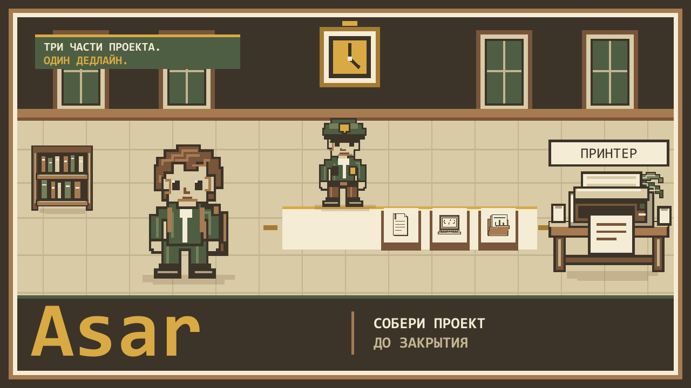

# Asar — a campus deadline game

Collect three pieces of a student project and reach the printer before your moves run out. **Asar** is a browser based pixel game built for iDos Games. Its name comes from the Kazakh tradition of helping one another with a difficult task.

[Play on iDos Games](https://idosgames.com/app/KJ56QZ5E/) · [Open the game directly](https://kj56qz5e.idos.games/) · [GitHub Pages build](https://era216.github.io/asar-2359/) · [Русский README](README.ru.md)



## The game

- Gather the text, code and slides, then reach the printer within the move limit.
- Play generated, solvable maps that grow with the level. A guard patrols from level 21 onward.
- Explore three repeating settings: campus (levels 1–10), cafeteria (11–20) and night campus (21–30).
- Use the market for items and character skins; track progress in the side panel.
- Play with a keyboard or touch controls. Music and effects have separate volume settings.
- Send a friend a help link through the optional Solana feature.

### Controls

Use **arrow keys** or **WASD** on a computer. On a phone, use the on screen movement controls. The in game **?** button opens the tutorial again.

## Solana integration and current limits

Phantom is optional: the core game can be played without a wallet. Wallet connection enables the game's Solana features. Help links and Memo records use **Solana Devnet** and require test SOL for transaction fees. A help link points to the published game so another player can open the gift.

The coins shown in the market are **local game currency, not ASAR tokens**. They are available only when a wallet is connected and are stored locally per wallet address. The ASAR mint exists on **Solana Mainnet**, but this game does **not** currently transfer or award ASAR. The experimental server verification work is documented in [docs/SERVER_REWARDS.md](docs/SERVER_REWARDS.md); it is not a live token payout system.

Never enter a seed phrase or other secret into a public Memo.

## Run locally

Requires Node.js **20.19+** or **22.12+** and npm.

```sh
npm ci
npm run dev
```

Vite prints the local URL. For a production build, run `npm run build`; the generated files go to `dist/`. Run the local checks with `npm test`. The DEV iDos Cloud Code integration test (`npm run test:cloudcode:dev`) needs access to its external DEV environment and is separate from the local checks.

## Repository map

| Path | Purpose |
| --- | --- |
| `index.html`, `src/` | Game page, logic, visuals and interface |
| `assets/` | Pixel art and audio |
| `tests/` | Local gameplay and reward policy checks |
| `cloudcode/` | Experimental iDos DEV Cloud Code |
| `docs/` | Development history and reward status |
| `.github/workflows/` | Checks and GitHub Pages deployment |

## Publishing

The `main` branch builds to GitHub Pages through [the deployment workflow](.github/workflows/deploy.yml). GitHub Pages needs **GitHub Actions** selected as its Pages source. This build uses the `/asar-2359/` base path.

Publishing to iDos Games is a **separate, manual** step. The title ID is `KJ56QZ5E`. To prepare a versioned iDos build, request an `AssetBase` with `begin_build_upload`, then run `npm run build -- --base="<AssetBase>"` and upload the **contents** of `dist/` with `index.html` at the archive root. A GitHub push does not update the iDos game.
